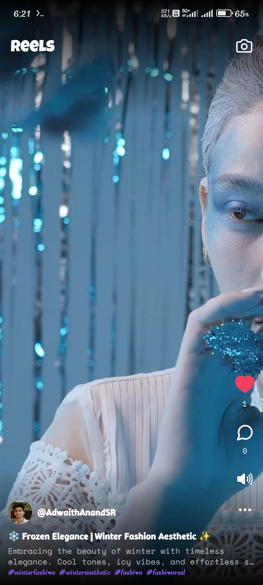
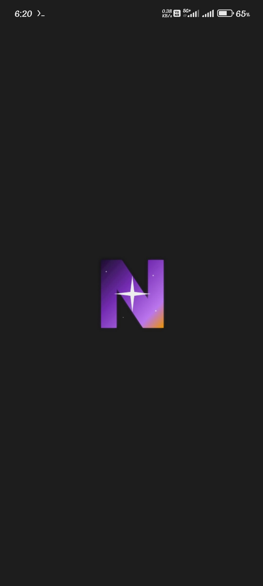
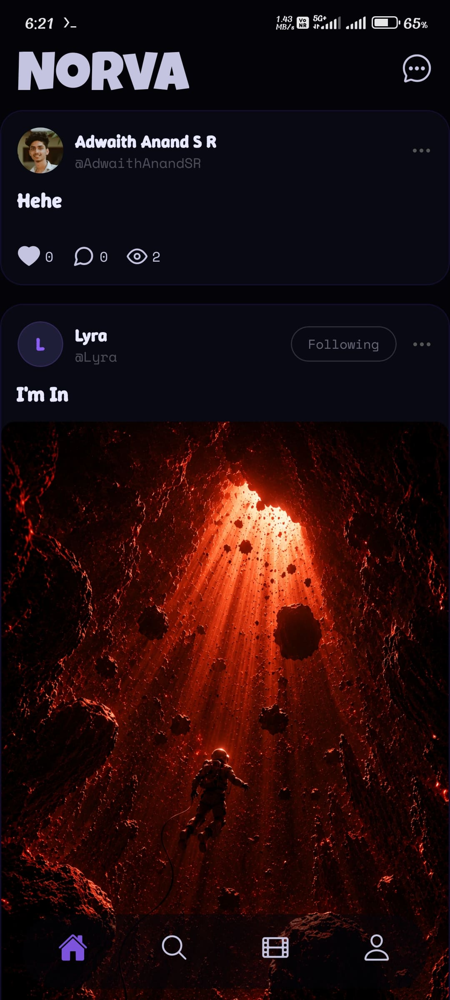
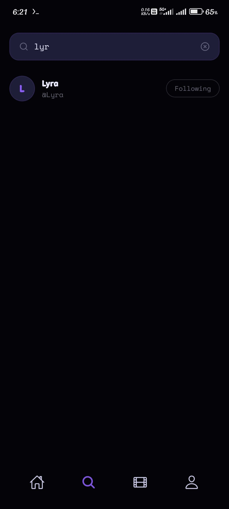
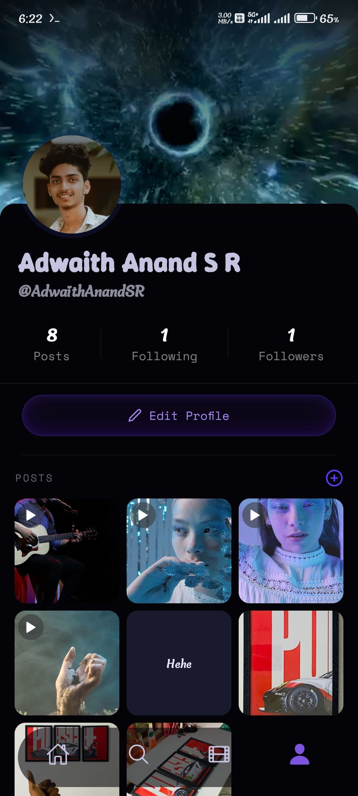
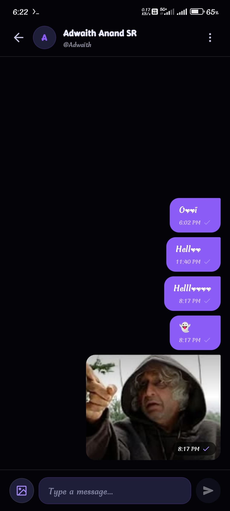

<div align="center">

# 🚀 Norva

**A Full-Stack Real-Time Social Media Platform Built with React Native, Expo & Express**

[](https://reactnative.dev/)
[](https://expo.dev/)
[](https://nodejs.org/)
[](https://expressjs.com/)
[](https://www.mongodb.com/)
[](https://socket.io/)
[](https://www.typescriptlang.org/)
[](https://drive.google.com/file/d/10padADGu13Lavtp4S9j4BVngUM9zenc_/view?usp=drivesdk)

</div>

---

## 🌟 Overview

**Norva** is a high-performance, full-stack social media application platform designed for real-time interaction, rich media sharing, and seamless user experiences across iOS, Android, and Web.

Engineered with a modern mobile frontend architecture powered by **Expo Router**, **TanStack React Query**, **Zustand**, and **MMKV**, coupled with a robust **Express 5** backend featuring **WebSockets**, **MongoDB**, and **Cloudinary** media infrastructure.

---

## 🎬 App Video Demo

<div align="center">

[](https://drive.google.com/file/d/10padADGu13Lavtp4S9j4BVngUM9zenc_/view?usp=drivesdk)

<br /><br />

[](https://drive.google.com/file/d/10padADGu13Lavtp4S9j4BVngUM9zenc_/view?usp=drivesdk)

<br />

> 🍿 **[Click here to watch the full edited video demo on Google Drive](https://drive.google.com/file/d/10padADGu13Lavtp4S9j4BVngUM9zenc_/view?usp=drivesdk)**

</div>

---

## 📱 Screenshots

<div align="center">

| Splash Screen | Home Feed | Search | Reels |
| :---: | :---: | :---: | :---: |
|  |  |  |  |

<br />

| User Profile | Direct Messages | Chat Conversation |
| :---: | :---: | :---: |
|  |  |  |

</div>

---

## ✨ Features

- 🔐 **Secure Authentication**: JWT-based access & refresh token strategy with server-side JTI revocation blacklisting.
- 📰 **Interactive Social Feed**: Create, view, like, and comment on rich media posts with dynamic pagination.
- 💬 **Real-Time Direct Messaging**: Instant 1-on-1 socket-driven messaging powered by Socket.io.
- 📸 **Cloud Media Uploads**: High-resolution image & media processing integrated with Cloudinary.
- 👤 **Customizable User Profiles**: Avatar uploads, bio management, dynamic follower/following relations, and personal post galleries.
- 🔔 **Push Notifications**: Expo Server SDK integration for instant social updates (likes, comments, chat messages, follow events).
- ⚡ **Ultra-Fast Local Storage**: Encrypted key-value client storage powered by `react-native-mmkv`.
- 🎨 **Modern Design & Animations**: Styled with Tailwind CSS / Uniwind, FlashList for high-performance scrolling, and React Native Reanimated v4 animations.

---

## 🏗 System Architecture

```
+-------------------------------------------------------+
|                   Client (Expo / React Native)        |
|  - Expo Router (File-based Routing)                   |
|  - TanStack React Query + Axios (HTTP API Layer)      |
|  - Zustand Store (State) + MMKV (Local Storage)       |
|  - Socket.io Client (Real-Time Messaging & Events)    |
+---------------------------+---------------------------+
                            |
                     HTTP / WebSocket
                            |
+---------------------------v---------------------------+
|                  Server (Node.js / Express 5)         |
|  - Express App + HTTP Server                          |
|  - Socket.io Server (Real-Time WebSockets)            |
|  - JWT Authentication Middleware                      |
|  - REST Controllers (Auth, User, Post, Chat, File)   |
|  - Cloudinary SDK Service (Media Processing)          |
|  - Mongoose ODM -> MongoDB Database                   |
+-------------------------------------------------------+
```

---

## 📂 Project Structure

```
Norva/
├── client/                     # Expo / React Native Frontend
│   ├── assets/                 # Custom fonts, images, splash assets
│   ├── src/
│   │   ├── app/                # Expo Router screen navigation hierarchy
│   │   │   ├── _layout.tsx     # Root stack layout, fonts & auth guards
│   │   │   ├── auth/           # Unauthenticated screens (Signin, Signup)
│   │   │   └── (secure)/       # Protected authenticated routes
│   │   │       ├── (tabs)/     # Bottom Tab navigation (Feed, Search, Profile)
│   │   │       ├── (models)/   # Overlay screens & media modals
│   │   │       └── (others)/   # Sub-flows (Edit Profile, Chat, Single Post)
│   │   ├── components/         # Feature UI components (feed, profile, search)
│   │   ├── constants/          # Application design tokens & theme constants
│   │   ├── controllers/        # React Query hooks for asynchronous API calls
│   │   ├── hooks/              # Custom utility React hooks
│   │   ├── storage/            # MMKV encrypted local storage abstraction
│   │   ├── store/              # Zustand global state stores
│   │   └── utils/              # Axios instance, image pickers, Cloudinary helpers
│   ├── app.json                # Expo project configuration
│   └── package.json            # Client dependencies & run scripts
│
└── server/                     # Express / Node.js Backend API
    ├── config/                 # Database & Cloudinary configurations
    ├── controllers/            # Business logic handlers (Auth, Feed, User, Chat)
    ├── middleware/             # Express middlewares (JWT auth verification)
    ├── models/                 # Mongoose schemas (User, Post, Comment, Token)
    ├── routes/                 # API endpoint routers
    ├── services/               # Socket.io real-time & Expo push notifications
    ├── utils/                  # JWT token helpers & response formatters
    ├── server.js               # Application entry point
    └── package.json            # Backend dependencies & run scripts
```

---

## 🛠 Tech Stack

### Frontend (Client)
- **Framework**: [Expo (SDK 57)](https://expo.dev/) & [React Native (0.86)](https://reactnative.dev/)
- **Routing**: [Expo Router](https://docs.expo.dev/router/introduction/)
- **State Management**: [Zustand](https://github.com/pmndrs/zustand)
- **Data Fetching**: [TanStack React Query (v5)](https://tanstack.com/query/latest)
- **Local Storage**: [React Native MMKV](https://github.com/mrousavy/react-native-mmkv)
- **Styling & UI**: Tailwind CSS, Uniwind, React Native Reanimated v4, `@shopify/flash-list`
- **Real-Time Client**: `socket.io-client`

### Backend (Server)
- **Runtime**: [Node.js](https://nodejs.org/) (ES Modules)
- **Framework**: [Express 5](https://expressjs.com/)
- **Database**: [MongoDB](https://www.mongodb.com/) with [Mongoose ODM](https://mongoosejs.com/)
- **Real-Time WebSockets**: [Socket.io](https://socket.io/)
- **Media Processing**: [Cloudinary SDK](https://cloudinary.com/) & [Multer](https://github.com/expressjs/multer)
- **Authentication**: `jsonwebtoken` & `bcryptjs`
- **Push Notifications**: `expo-server-sdk`

---

## ⚙️ Environment Setup

### 1. Server Environment (`server/.env`)
Create a `.env` file in the `server/` directory:

```env
# Server Port
PORT=3000

# Database Configuration
DB_USER=your_mongodb_username
DB_PASSWORD=your_mongodb_password

# Cloudinary Storage
CLOUDINARY_CLOUD_NAME=your_cloud_name
CLOUDINARY_API_KEY=your_api_key
CLOUDINARY_API_SECRET=your_api_secret

# JWT Secrets
JWT_ACCESS_SECRET=your_jwt_access_secret_key
JWT_REFRESH_SECRET=your_jwt_refresh_secret_key
```

### 2. Client Environment (`client/.env`)
Create a `.env` file in the `client/` directory:

```env
# Encrypted MMKV Storage Key
EXPO_PUBLIC_MMKV_ENCRYPTION_KEY=your_secure_encryption_key

# Backend API Endpoint
EXPO_PUBLIC_API_URL=http://localhost:3000
```

---

## 🚀 Quick Start

### Prerequisites
- Node.js `v18.x` or higher
- npm or yarn package manager
- Expo Go app on mobile device or Android Studio / Xcode simulators

### 1. Start the Backend Server

```bash
cd server
npm install
npm run dev
```

The backend server will start at `http://localhost:3000`.

### 2. Start the Mobile Client

```bash
cd client
npm install
npm run start
```

Use the printed QR code in the terminal to open the app via **Expo Go**, or run:
- Press `a` or run `npm run android` for Android emulator
- Press `i` or run `npm run ios` for iOS simulator
- Press `w` or run `npm run web` for Web browser

---

## 🔌 API Endpoints Summary

| Method | Endpoint | Description | Auth Required |
| :--- | :--- | :--- | :---: |
| `POST` | `/auth/signup` | Register a new user account | ❌ |
| `POST` | `/auth/signin` | Log in and receive Access/Refresh JWTs | ❌ |
| `POST` | `/auth/refresh` | Obtain fresh Access token using Refresh token | ❌ |
| `GET` | `/user/profile` | Get logged-in user profile details | ✅ |
| `PATCH` | `/user/update` | Update user profile, bio, avatar | ✅ |
| `POST` | `/user/follow/:id` | Follow / Unfollow target user | ✅ |
| `GET` | `/post/feed` | Retrieve paginated social feed posts | ✅ |
| `POST` | `/post/create` | Create a new post with image/video media | ✅ |
| `POST` | `/post/like/:id` | Like or unlike a post | ✅ |
| `POST` | `/post/comment` | Add a comment to a post | ✅ |
| `POST` | `/file/upload` | Upload media files to Cloudinary | ✅ |
| `GET` | `/chat/messages` | Fetch chat conversation history | ✅ |

---

## 🤝 Contributing

Contributions are welcome! Please follow these steps:
1. Fork the project repository.
2. Create your feature branch (`git checkout -b feature/AmazingFeature`).
3. Commit your changes (`git commit -m 'Add some AmazingFeature'`).
4. Push to the branch (`git push origin feature/AmazingFeature`).
5. Open a Pull Request.

---

## 📄 License

This project is licensed under the ISC License.
